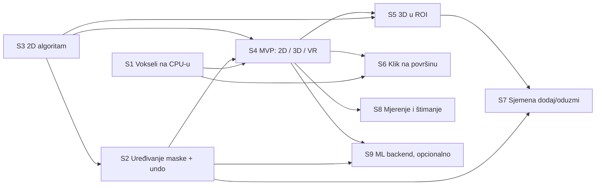

# Magic brush: razrada (bez implementacije)

Grana: `feature/magic-brush-research` (od `feature/volume-format`, `a8e95e8`). Datum: 2026-11-03.
Runtime kod nije mijenjan. Ovaj dokument je ujedno handoff za sesije u poglavlju 5.

**Cilj:** klik ne boji samo krug kista, nego označi logično područje oko točke (organ, tumor, žilu).
Kao kanta u Paintu, samo pametnije: poštuje granice tkiva, ne curi kroz tanke spojeve i radi u 2D
sliceu, u 3D prikazu i u VR-u.

---

## 0. Ukratko

- **MVP:** 2D "magic wand" na trenutnom sliceu. Prag se računa iz okoline klika (srednja vrijednost ± k·σ).
  Rast je 4-povezan i ograničen radijusom. Erozija i rekonstrukcija ga ne puštaju kroz tanke mostove
  (anti-leak). Na kraju se zatvaraju rupe. Radi na CPU-u, u pozadinskoj niti (`Task.Run`), u čistom C#-u
  bez novih paketa. Isti klik radi u 2D panelu, u 3D-u (presjek s ravninom slicea) i u VR-u (zraka),
  jer sva tri već daju `(slice, px, py)`.
- **Prije MVP-a treba temelj:**
  1. CPU kopija voksela (loader je sad baca nakon uploada).
  2. API za upis regije u masku, s načinima *dodaj* i *oduzmi*.
  3. **Poništavanje** (undo): jedan klik mijenja tisuće piksela, pa bez undoa alat nije upotrebljiv.
  4. Raspoređeno slanje maske na GPU, da veliki 3D rezultat ne zakoči VR.
- **Nadogradnje redom:**
  1. 3D rast u ograničenom volumenu (ROI), s anizotropnim razmakom voksela i rubnim stopom (gradijent).
  2. Odabir točke izravno na vidljivoj površini, bez ravnine slicea (bitno za VR).
  3. "Grow from seeds" (Fast GrowCut / geodetski) za ispravke potezima *dodaj/oduzmi*.
  4. Opcionalno ML (nnInteractive) kao vanjski servis.
- **Ne preporučujem za ovaj projekt:** level set, graph cut i random walker kao glavni alat. Daju dobru
  kvalitetu, ali su spori, imaju puno parametara i složenu implementaciju. Supervokseli preko cijelog
  volumena traže previše memorije i vremena. ML unutar Unityja 2021.3 nije realan.

---

## 1. Polazno stanje u kodu (što to znači za magic brush)

| Gdje | Što je tu | Posljedica za magic brush |
|---|---|---|
| `Annotation/AnnotationMaskManager.cs` | Maska je `Texture2DArray` R8, jedan element po sliceu. CPU kopija postoji samo za dotaknute sliceove (`Dictionary<int, byte[]> _slices`, vrijednosti 0/255). Izmjene se skupljaju u `_pending` i u `LateUpdate` šalju na GPU (`SetPixelData` u mali `Texture2D` + `Graphics.CopyTexture` po sliceu). | Format odgovara: rezultat regije je skup bajtova po sliceu. Treba nova metoda za upis regije (dodaj/oduzmi), jer sad postoji samo `PaintAt`/`PaintStroke` s krugom. |
| isto, `UpdateMarkedRange` | Pretpostavlja "kist ne briše": svaki slice u `_slices` je označen. | **Pukne čim postoji *oduzmi* ili undo.** Slice koji ostane prazan mora se izbaciti iz `_slices`, inače shader (`_MaskZRange`) i "oznaka kroz tkivo" rade s krivim rasponom. |
| isto, `Flush` | U jednom frameu šalje **sve** sliceove iz `_pending`. | 3D regija preko 60 sliceova znači 60 × (`SetPixelData` + `Apply` 256 KB + `CopyTexture`) u jednom frameu. To je procjena od 10–30 ms, pa se u VR-u (11 ms po frameu na 90 Hz) gubi frame. Treba ograničiti broj sliceova po frameu. |
| isto | Nema undoa (HANDOFF: "Zasebno: undo kista"). | Za magic brush undo više nije opcija nego uvjet. |
| `Loader/DicomVolumeLoader.cs`, `Building/DicomVolumeBuilder.cs` | `Build` vraća `VolumeBuffer` (`ushort[] Rg16`: gustoća + gradijent, 16 bita). `CreateTexture` zove `Apply(false, true)` (makeNoLongerReadable), a `buffer` je lokalna varijabla u `LoadAsync`. | **Na CPU-u nema voksela.** Najjednostavnije: loader zadrži `Rg16` (bez kopiranja) i izloži ga kao objekt samo za čitanje. Za 512×512×251 to je +263 MB RAM-a (+132 MB ako se čuva samo gustoća), a za 501 slice +525 MB. |
| `Building/GradientBaker.cs` | Gradijent = centralne razlike u vokselima (bez razmaka u mm), ×10, odrezan na [0,1]. | Upotrebljiv kao rubni stop u 3D-u. G ≈ 0,5 znači oko 200 HU razlike preko 2 voksela. Razmak se zanemaruje, pa je z-gradijent na 2,5 mm sliceovima "mekši". U 2D-u je bolje računati gradijent u ravnini iz same gustoće. |
| `Building/VolumeGeometry.cs` | Gustoća = (HU + 1000) / 4000, dakle 1 HU ≈ 16,4 jedinice u `ushort`. | Tolerancije se mogu prikazivati i zadavati u HU (CT). Za MR HU nema smisla; tu odgovara statistički prag. |
| `UI/SliceAnnotationPainter.cs` (2D) | Klik daje `(CurrentSliceIndex, px, py)` preko `SliceViewController.TexelIndex`. | Sjeme za 2D već postoji. Napomena u kodu o mogućem Y-flipu nije provjerena. Magic brush će to odmah pokazati: regija se pojavi zrcaljeno od mjesta klika. |
| `UI/VolumeSlicePainter.cs` (3D) | `TryHitSlice`: zraka iz kamere presijeca aksijalnu ravninu trenutnog slicea i daje `(slice, px, py)`. Za VR isto radi `PaintWithRay`. | Sjeme za 3D i VR već postoji, ali samo na ravnini slicea. Klik na vidljivu površinu bez ravnine je zasebna nadogradnja (S6). |
| `Xr/VrVolumeController.cs` | Desni okidač u načinu crtanja crta. Desni touchpad gore/dolje mijenja veličinu kista. `VrMenu` ima retke s gumbima i haptiku. | U magic načinu: okidač = klik regije, touchpad gore/dolje = osjetljivost (umjesto veličine kista). U izbornik idu novi retci (alat, osjetljivost, dodaj/oduzmi, poništi). |
| Indeksi | Volumen: `voxel = z·W·H + y·W + x`. Maska: slice `z`, piksel `y·W + x`. Obje teksture pune se istim `SetPixelData` redoslijedom. | Piksel maske `(x, y)` na sliceu `z` je točno voksel `(x, y, z)`. Nema preslikavanja. |
| Podaci | `series-000003` sadrži dvije isprepletene akvizicije s rupama (HANDOFF, "Nalaz"). Razmak je 0,9 × 0,9 × 2,5 mm. | **3D rast se ne smije štimati na toj seriji**, jer susjedni sliceovi nisu susjedni u prostoru. 2D na njoj radi normalno. Za 3D treba ispravna CT serija (i jedna MR). |
| Testovi | `Tests~/MaskSerializerTests`, `Tests~/VolumeGeometryTests`: čisti C# povezan u xUnit (`dotnet test`, `DOTNET_ROLL_FORWARD=Major`). | Algoritme pisati kao čisti C# (bez `UnityEngine`, bez `Mathf`), pa se testiraju istim obrascem: `Tests~/SegmentationTests`. |
| Paketi | Nema asmdefa, nema Bursta ni Collectionsa. `Parallel.For` se već koristi. | MVP ide bez novih paketa. Burst + Jobs (Unityjevi paketi) samo ako mjerenje pokaže da C# ne stiže. |

---

## 2. Pregled pristupa

Zajedničke oznake: **N** = broj voksela u području rada. Brzine su **procjene** za C# (Mono u Editoru) na
jednoj jezgri, osim gdje piše drugačije. Treba ih potvrditi mjerenjem (sesija S8).
ROI = ograničeno područje oko klika, npr. krug ili kugla radijusa 40–60 mm.

### 2.1 Usporedna tablica

| # | Pristup | CT | MR | Brzina (2D slice / 3D ROI 128³) | Složenost | Šum | Curenje | Kontrola korisnika | 2D/3D | Za projekt |
|---|---|---|---|---|---|---|---|---|---|---|
| 1 | Region growing, fiksni prag [lo, hi] | dobro za visok kontrast (kost, zrak, kontrast u žilama), loše za meko tkivo | loše (nema apsolutne skale, nehomogenost polja) | ~2–5 ms / ~30–80 ms | vrlo niska | rupe i "sol" | **jako** (kroz svaki spoj iste gustoće) | prag (2 broja), dodaj/oduzmi trivijalno | oba | dio MVP-a (kao jezgra) |
| 2 | Statistički prag μ ± k·σ iz okoline klika | dobro za homogene organe i tumore | dobro lokalno, jer se prilagođava | isto kao 1 (+ statistika) | niska | osjetljiv na σ, pa treba donja granica tolerancije | jako bez zaštite | **jedan klizač (k)**, intuitivno | oba | **MVP** |
| 3 | Confidence connected (ITK): 2–4 iteracije, μ i σ iz rastuće regije | kao 2, stabilnije na rubu klika | kao 2 | 2–4× od 2 | niska | bolje od 2 (statistika iz više voksela) | σ može "puhati" kroz iteracije pa curi | k + broj iteracija | oba | opcija u MVP-u (1 parametar više) |
| 4 | Rast s rubnim stopom (gradijent > g ne prolazi) | dobro na jasnim rubovima | srednje (rubovi slabiji, šum) | +10–20 % na 1/2 | niska | šum diže gradijent pa rast staje prerano | manje, ali curi kroz slab rub | prag gradijenta | oba (G kanal postoji za 3D) | **faza 2** (3D), opcija u 2D |
| 4b | Geodetski rast (Dijkstra, cijena = razlika gustoće + gradijent, limit udaljenosti) | dobro | dobro | 3–5× od 1 (prioritetni red) | srednja | dobro (cijena se zbraja) | malo uz razuman limit | limit cijene = osjetljivost | oba | osnova za fazu 3 |
| 5 | Anti-leak: erozija → rast → geodetska dilatacija (otvaranje rekonstrukcijom) | jako pomaže između organa | jako pomaže | +r prolaza (r = 1–3) | niska | izglađuje | **spoj uži od 2r+1 se ne prelazi** | radijus u mm | oba (anizotropno u 3D) | **MVP** (kao dodatak na 2) |
| 6 | Kist ograničen pragom ("adaptivni kist") | dobro | dobro | trivijalno | vrlo niska | ok | nema (unutar kista) | veličina kista + prag | oba | brzi dodatak uz MVP |
| 7 | Watershed s markerima (na gradijentu) | dobri rubovi | dobri rubovi | 2D ~20–50 ms / 3D ~0,3–1 s | srednja | bez markera previše regija | curi kroz slab rub, ali staje na grebenu | markeri dodaj/oduzmi | oba | ne kao glavni; ideja za "adaptivni kist" |
| 8 | Level set / geodetska aktivna kontura | vrlo glatko, točno uz štimanje | dobro | sekunde (CPU), GPU moguć | **visoka** | dobro (zakrivljenost gladi) | ovisi o parametrima | slaba (puno parametara, iterativno) | oba | ne |
| 9 | GrowCut / Fast GrowCut ("Grow from seeds" u 3D Sliceru) | vrlo dobro | vrlo dobro | 3D ROI ~0,3–1 s, inkrementalno brže | srednja | dobro | malo (natjecanje oznaka) | **sjemena dodaj/oduzmi**, prirodno | oba | **faza 3** |
| 10 | Graph cut (max-flow, Boykov–Jolly) | vrlo dobro | vrlo dobro | 3D ROI ~1–3 s, memorija ~6 bridova po vokselu | **visoka** (max-flow u C#) | dobro | malo | sjemena dodaj/oduzmi | oba | ne (licenca BK biblioteke, složenost) |
| 10b | Random walker | vrlo dobro, i na slabim rubovima | vrlo dobro | 3D ROI 64³ ~0,5–2 s (CG), GPU moguć | visoka | dobro | malo | sjemena | oba | ne (možda kasnije na GPU-u) |
| 11 | Superpikseli / supervokseli (SLIC) + klik bira dijelove | srednje (rub kvantiziran) | srednje | predračun: 2D ~50–150 ms po sliceu, 3D cijeli volumen sekunde do minute; klik trenutan | srednja | dobro | ograničeno veličinom superpiksela | broj/veličina, dodaj/oduzmi dijelove | oba | ne (memorija: int32 oznaka po vokselu ≈ 263 MB) |
| 12 | ML: SAM/MedSAM (2D, okvir), MedSAM2 (3D/video), nnInteractive (3D, točke/potezi/okvir/laso) | najbolje za teška meka tkiva | najbolje | GPU: ~0,1–2 s po upitu; CPU bar 10× sporije | **vrlo visoka** integracija | robusno | malo | pozitivne/negativne točke, potezi | 2D i 3D | **faza 4, opcionalno**, vanjski servis |
| 13 | Kombinacije (vidi 2.3) | — | — | — | — | — | — | — | — | **preporuka** |

### 2.2 Pristupi pojedinačno

**1. Region growing po fiksnom pragu ("kanta").** Flood fill od klika kroz sve susjede s gustoćom u
[lo, hi]. Za CT ima smisla kad je struktura kontrastna: kost (> 200 HU), pluća i zrak (< −500 HU),
kontrast u žilama i bubrezima. Za meko tkivo (jetra, slezena, mišić su svi oko 40–60 HU) procuri u
susjedni organ kroz prvi dodir. Za MR fiksni prag nema smisla: skala nije apsolutna i postoji
nehomogenost polja. Implementacija je red za obradu (BFS) nad bajtnim poljem "posjećeno", desetak redaka.
Ovo je **jezgra** svih ostalih klasičnih varijanti. Sam za sebe nije dovoljno pametan.

**2. Statistički prag (μ ± k·σ).** Iz malog prozora oko klika (5×5 u 2D, 3×3×3 u 3D) računa se srednja
vrijednost i standardna devijacija. Interval je [μ − t, μ + t], uz t = k·σ, ograničen na
[minTol, maxTol] (npr. 15–300 HU). Korisnik vidi jedan klizač, *osjetljivost* = k. Prilagođava se
tkivu na koje se kliknulo, pa radi i za MR.

Problemi i rješenja:
- U homogenom tkivu σ je sitan, pa regija ispadne "šupljikava". Rješenje je donja granica `minTol`.
- Ako prozor zahvati rub, σ naraste i regija curi. Rješenje: robusna statistika (medijan i MAD × 1,4826)
  i "klizanje sjemena" na voksel s najmanjim gradijentom unutar 1–2 px od klika.

**3. Confidence connected.** Varijanta od 2 iz ITK-a: rast s μ ± k·σ, pa ponovno μ i σ iz cijele regije,
pa ponovni rast, ukupno 2–4 puta. Statistika je stabilnija jer dolazi iz tisuća voksela, a ne iz 25.
Rizik je da svaka iteracija proširi interval i regija "odluta". Zato najviše 2–3 iteracije, uz istu
gornju granicu tolerancije. Vrijedi kao opcija ("stabilnije"), ne kao zadano.

**4. Flood s gradijentnim ili rubnim stopom.** Voksel ulazi samo ako mu je i gustoća u intervalu i
gradijent ispod praga g. U 3D-u se G kanal već nalazi u `Rg16` (besplatno). U 2D-u se gradijent računa u
ravnini iz gustoće (2 oduzimanja po pikselu), jer pohranjeni G uključuje susjedne sliceove. Pomaže
točno tamo gdje statistički prag zakaže: dva tkiva slične gustoće s tankom granicom. Na šumnim
podacima (low-dose CT, MR) gradijent šuma prelazi g, pa rast staje prerano. Zato zadano isključeno u 2D,
uključeno u 3D uz blagi prag.

**4b. Geodetski rast.** Umjesto "da/ne" po vokselu, Dijkstra od sjemena s cijenom koraka
|Δgustoće| + α·gradijent. Uzima se sve s ukupnom cijenom ispod limita. Curenje kroz dug, tanak spoj
skupo je jer se cijena zbraja, pa je ovo prirodno otporno na curenje. Sporije je zbog prioritetnog reda.
To je ista matematika kao Fast GrowCut s jednom oznakom (vidi 9).

**5. Anti-leak (otvaranje rekonstrukcijom).** Ključni trik za "ne curi kroz tanke spojeve":
1. T = vokseli koji zadovoljavaju kriterij (2/3/4).
2. E = T erodiran za r. Spojevi uži od 2r+1 nestanu.
3. R = flood od sjemena kroz E.
4. Regija = R geodetski proširen za r koraka, ali samo unutar T. Oblik se vrati, mostovi ne.

Ako sjeme ne preživi eroziju (klik u tankoj strukturi, npr. žila), r se smanjuje do 0. Tako se regija
ponaša kao obična kanta. r se zadaje u mm i preračunava po osi (0,9 mm u ravnini, 2,5 mm u z: za 2 mm je
rx = ry = 2, rz = 1). Isto radi 3D Slicer "Flood filling" (parametar *neighborhood size*) i ITK
`NeighborhoodConnected`. Jeftino je: r prolaza po ROI-u.

**6. Kist ograničen pragom ("adaptivni kist").** Postojeći krug kista boji samo piksele u intervalu oko
gustoće ispod središta kista (ili μ ± k·σ). ITK-SNAP to radi watershedom unutar kista, a Slicer
"Paint" ima "editable intensity range". Nije klik-regija, ali je odličan alat za rubove i dorade, a
implementacija je deset redaka u `PaintSlice`. Ne curi, jer je ograničen krugom.

**7. Watershed.** "Poplava" od markera po slici gradijenta. Granice se postavljaju na grebene gradijenta
(rubove). Bez markera daje stotine regija (preveliku segmentaciju). S markerima (klik = objekt, prsten ili
potez = pozadina) radi dobro, ali traži i pozadinske markere, pa je UX za jedan klik slabiji.
Implementacija je prioritetni red, srednje složenosti. Za projekt je zanimljiv samo kao unutarnji dio
"adaptivnog kista" ili faze 3.

**8. Level set / geodetska aktivna kontura.** Kontura se iterativno širi od sjemena, a usporava na rubu
(slika brzine iz gradijenta). Zakrivljenost je drži glatkom. Daje lijepe, glatke rezultate (ITK-SNAP
"snake"), ali traži 3–5 parametara, sekunde računanja i iterativno gledanje dok raste. U VR-u i uz jedan
klik to je loš UX. Implementacija (narrow band, reinicijalizacija) je najsloženija od klasičnih. **Ne.**

**9. GrowCut / Fast GrowCut.** Korisnik da sjemena objekta i pozadine (klik, potez). Svaki voksel dobije
oznaku sjemena do kojeg je "najjeftiniji put" (Fast GrowCut = Dijkstra s više oznaka, Zhu i sur. 2014;
3D Slicer "Grow from seeds"). Natjecanje oznaka sprječava curenje bez ručnog praga. Novi potez
*oduzmi* samo lokalno preračuna dio, pa je ispravljanje brzo (inkrementalno). Kvaliteta na CT-u i MR-u je
vrlo dobra. Treba ROI, jer 3D na cijelom volumenu traje sekundama. Ovo je **prirodna faza 3**, jer daje
točno *dodaj/oduzmi* kontrolu.

**10. Graph cut / random walker.**
- **Graph cut (max-flow):** globalno optimalna podjela objekt/pozadina uz sjemena. Kvaliteta je odlična.
  Treba max-flow nad grafom sa ~6 bridova po vokselu (memorija, složenost). Poznata BK implementacija je
  GPL ili za istraživačku uporabu (provjeriti), a vlastita u C#-u nije trivijalna.
- **Random walker:** vjerojatnost da slučajna šetnja od voksela prvo stigne do sjemena objekta. Dobar na
  slabim rubovima, ali rješava velik rijedak linearni sustav (CG), pa je spor na CPU-u.

Oba daju malo bolje od Fast GrowCuta za puno više posla. **Ne**, osim kao kasniji GPU eksperiment.

**11. Superpikseli / supervokseli.** Volumen se unaprijed podijeli na male homogene komadiće (SLIC), a klik
bira komadić i spaja susjedne slične. Interakcija je trenutna, ali:
- predračun za cijeli 3D volumen traje sekundama do minuta i treba int32 oznaku po vokselu (≈ 263 MB za
  512×512×251);
- rub regije je kvantiziran veličinom komadića;
- parametri utječu na rezultat.

U 2D-u, po sliceu na zahtjev, bilo bi izvedivo, ali ne daje ništa što 2 + 5 ne daju jednostavnije. **Ne.**

**12. ML (SAM/MedSAM, MedSAM2, nnInteractive).**
- *SAM/MedSAM*: 2D. MedSAM očekuje okvir (box), klik je slabiji. Postoje lakše varijante za laptop
  (LiteMedSAM i slične iz izazova CVPR 2024).
- *MedSAM2* (travanj 2025): 3D i video, propagira kroz sliceove. Licenca na Hugging Faceu je
  CC BY-SA 4.0 "samo za istraživanje i obrazovanje", a GitHub navodi Apache 2.0. Treba provjeriti.
- *nnInteractive* (DKFZ, 2025): pravi 3D, pozitivne i negativne točke, potezi, okvir, laso. Trenutno
  najbolja kvaliteta u benchmarkovima, integriran u 3D Slicer, MITK i Napari. Kod je pod Apache 2.0, a
  **težine pod CC BY-NC-SA 4.0** (nekomercijalno). Treba NVIDIA GPU sa 6–10 GB VRAM-a. Na CPU-u je
  barem 10× sporiji. Ima udaljeno sučelje preko HTTP-a.

Ograničenja za ovaj projekt:
- **Unity 2021.3 nema prikladan inference runtime.** Sentis 2.x i Inference Engine ciljaju Unity 6.
  Barracuda je zastarjela i ne podržava ove arhitekture.
- Python/PyTorch može ići samo kao **vanjski proces**: lokalni ili LAN server, volumen se pošalje jednom,
  a upiti su točke.
- Na istom PC-u ML dijeli GPU s VR renderiranjem, pa će tijekom upita padati frameovi. Bolje je zasebno
  računalo.

Zaključak: **faza 4, opcionalno**, iza sučelja, tek kad klasični alat radi.

### 2.3 Kombinacije (ono što se zapravo isplati)

| Kombinacija | Što daje | Kad |
|---|---|---|
| **2 + 5 + ROI + zatvaranje rupa** (+ opcija 3) | Jedan klik, jedan klizač, ne curi kroz tanke spojeve, ne preplavi tijelo (radijus), čista regija bez rupa. | **MVP (2D)** |
| Isto u 3D + 4 (G kanal) + anizotropna erozija | Organ ili tumor u 3D-u jednim klikom, uz rubni stop gdje prag ne razlikuje tkiva. | Faza 2 |
| 2D rezultat + propagacija na susjedne sliceove (2,5D): rezultat slicea z daje statistiku i sjeme za z±1, staje kad se površina naglo promijeni | Prirodno za masku po sliceu i za anizotropne podatke; korisnik vidi slice po slice. | Alternativa 3D-u ako 3D curi kroz z (debeli sliceovi). Odluka nakon S8. |
| 6 (adaptivni kist) uz magic brush | Brza ručna dorada ruba bez curenja. | Uz MVP (mali dodatak) |
| 4b/9 (geodetski, Fast GrowCut) s potezima dodaj/oduzmi | Ispravak curenja jednim negativnim potezom umjesto gumice. | Faza 3 |
| ML prijedlog + klasična dorada (5, 9) | ML za teška meka tkiva, klasika i undo za korekcije. | Faza 4 |

---

## 3. Ograničenja projekta i što iz njih slijedi

| Ograničenje | Posljedica za dizajn |
|---|---|
| **Unity 2021.3, Built-in** | Compute shaderi rade (DX11 na Windowsu, Vive), ali nisu potrebni za MVP. Maska živi na CPU-u (`_slices`), pa je CPU algoritam prirodan. GPU varijanta bi trebala povratno čitanje (`AsyncGPUReadback`, 1–3 framea kašnjenja) da maska ostane jedan izvor istine. Nema Sentisa, pa ML samo izvana. |
| **Vive VR, latencija nakon klika** | Na 90 Hz frame ima 11 ms. Pravila: (1) algoritam **uvijek** u `Task.Run` (kao loader), nikad na glavnoj niti; (2) rezultat se primjenjuje na glavnoj niti, a na GPU ide **u obrocima** (npr. najviše 8 sliceova ili ~3 ms po frameu); (3) odmah vidljiva povratna informacija: zraka žuta "računam", haptika kad je gotovo; (4) novi klik ili pomak klizača otkazuje stari posao (`CancellationToken`). **Ciljevi:** klik → vidljivo ≤ 150 ms (2D), ≤ 400 ms (3D ROI); alat ne smije uzrokovati frame > 11 ms (provjera: `VrFrameStats`). |
| **Maska se sprema po sliceu** | Rezultat algoritma je `MaskRegion`: pravokutnik + bajtovi po sliceu, samo za dotaknute sliceove. Manager ga spaja u `_slices` (dodaj = ILI, oduzmi = I-NE). 2D rezultat je regija s jednim sliceom, pa isti put služi za 2D, 3D i ML. Format na disku (`MaskSerializer`) se ne mijenja. |
| **Bez teških ovisnosti** | Ne: ITK/SimpleITK (nativne DLL-ove od ~100 MB za 10 funkcija), OpenCV (OpenCvSharp ili plaćeni asset), Python u procesu. Da: čisti C# + `System.Threading.Tasks`. Burst i Collections (Unityjevi paketi) tek ako mjerenje pokaže potrebu. ML samo kao vanjski proces iza sučelja. |
| **Memorija** | CPU voksel buffer: +263 MB za 512×512×251 (RG32), +525 MB za 501 slice. Prijedlog: čuvati ga samo kad je anotacija uključena (polje `keepVoxelsOnCpu` na loaderu, zadano uključeno u scenama s anotacijom). Undo stog ograničiti po bajtovima (npr. 256 MB). |
| **Testabilnost** | Algoritmi su čisti C# (System.Math, bez `UnityEngine`) u `Assets/DicomRuntime/Segmentation/`, testirani u `Tests~/SegmentationTests` sa sintetičkim slikama (dva diska spojena mostom od 1 px, šumni disk, klik u pozadinu). Isti obrazac kao `MaskSerializerTests`. |
| **Undo** | Jedan klik može promijeniti 60 sliceova. Undo postaje uvjet MVP-a. Dizajn: operacija (`BeginEdit`/`EndEdit`) pamti **stanje prije** samo za dotaknute sliceove (`null` ako slice nije postojao). Undo vraća ta stanja. Isti mehanizam pokriva i postojeći kist (potez od pritiska do otpuštanja = jedna operacija). |
| **Interaktivno štimanje bez nove teksture** | Dok se drži klik (miš ili okidač), pomak gore/dolje (VR: touchpad) mijenja osjetljivost. Zadnja operacija se poništi i ponovno izračuna s novim k. Nema posebne "preview" teksture: koristi se undo, a otpuštanje potvrđuje. |
| **Paralelne sesije i scene** | `.unity` datoteke se loše spajaju u gitu. Izmjene scena (gumbi, klizači, reference) samo u S2 i S4 (i S7 ako treba), redom, ne paralelno. Čisti C# sesije (S1, S3, S5-algoritam) mogu paralelno. |

---

## 4. Preporuka: MVP pa nadogradnje

### Zadani parametri (polazište za štimanje u S8)

| Parametar | 2D | 3D | Napomena |
|---|---|---|---|
| Osjetljivost k | 2,5 (0,5–5) | 2,5 | klizač; t = k·σ |
| minTol / maxTol | 15 / 300 HU | 15 / 300 HU | za MR u jedinicama gustoće (≈ isto u `ushort`) |
| Prozor sjemena | 5×5 | 3×3×3 | medijan/MAD kao opcija "robusno" |
| Klizanje sjemena | do 2 px na najmanji gradijent | do 1 voksel | spriječi σ s ruba |
| Najveći radijus (ROI) | 60 mm | 40 mm | pretvoreno u voksele po osi |
| Anti-leak r | 2 mm | 2 mm (rz zaokružen, često 1) | 0 = isključeno |
| Rubni stop g | isključen (opcija, gradijent u ravnini) | 0,6 (G kanal) | 0 = isključeno |
| Povezanost | 4 | 6 | 8/26 curi lakše |
| Zatvaranje rupa | da, rupe do 200 mm² | po sliceu, rupe do 200 mm² | `MaxHoleAreaMm2`, 0 = sve rupe; veća rupa (organ u kliknutoj masnoći) ostaje otvorena |
| Najviše voksela | — (ROI ograničava) | 3 M | iznad toga prekid i poruka "smanji osjetljivost" |

### Algoritam MVP-a (2D, `RegionGrow2D.Run`)
1. ROI = kvadrat oko sjemena (najveći radijus), odrezan na sliku. Krug unutar njega.
2. Klizanje sjemena, zatim μ i σ (ili medijan i MAD) u prozoru, pa t = clamp(k·σ, minTol, maxTol).
3. T[i] = gustoća ∈ [μ − t, μ + t] (i opcionalno gradijent ≤ g), samo unutar kruga.
4. E = T erodiran za r. Ako sjeme nije u E: r = r − 1, ponovi (do r = 0).
5. R = flood (4-povezan) od sjemena kroz E.
6. R = geodetska dilatacija R za r koraka unutar T.
   6b. Uz rubni stop: još jedan korak dilatacije kroz interval gustoće (bez rubnog stopa), da se vrati
   sloj tik uz rub.
7. Zatvori rupe u R do `MaxHoleAreaMm2`: flood pozadine s ruba ROI-a; što nije dosegnuto, a nije u R, je
   rupa.
8. Rezultat: `MaskRegion` (pravokutnik ROI-a + bajtovi), broj piksela i zastavica `TouchedRoiBorder`
   ("možda curi", prikazati korisniku).

### Faze i kriteriji "gotovo kad…"

**Faza 0: Temelji** (S1, S2, S3). Ništa se ne mijenja za korisnika, osim što postoji undo.
- Gotovo kad:
  - loader nakon `OnVolumeLoaded` daje voksele;
  - indeks `(x, y, z)` voksela odgovara pikselu maske (test);
  - `ApplyRegion` s *dodaj/oduzmi* radi, a prazni sliceovi nestaju iz `_slices` (`_MaskZRange` točan,
    test);
  - Ctrl+Z, gumb i VR stavka poništavaju potez kista i regiju;
  - 100 sliceova na čekanju šalje se kroz više frameova (najviše N po frameu);
  - `RegionGrow2D` prolazi sintetičke testove (most od 1 px ne propušta uz r = 1, šumni disk se popuni,
    klik u pozadinu ne preplavi ROI) i radi 512×512 za < 20 ms u `dotnet test` (Release);
  - postojeći testovi i dalje prolaze.

**Faza 1: MVP magic brush u 2D, 3D (ravnina slicea) i VR-u** (S4).
- Gotovo kad:
  - u 2D panelu, u 3D-u (uključeno "Crtanje u 3D") i u VR-u (zraka) klik označi regiju na trenutnom
    sliceu, a Shift+klik ili način "oduzmi" je makne;
  - na ispravnoj CT seriji klik u jetru, bubreg, slezenu i jedan tumor ili cistu daje regiju bez curenja
    u susjedni organ, uz zadanu ili jednom pomaknutu osjetljivost (zapisati koje slučajeve);
  - klizač osjetljivosti i "drži i povuci" mijenjaju rezultat uživo;
  - klik → vidljivo ≤ 150 ms; u headsetu nema frameova > 11 ms zbog alata (`VrFrameStats`);
  - jedan undo vraća stanje prije klika;
  - spremi/učitaj masku radi kao prije.

**Faza 2: 3D regija i klik na površinu** (S5, S6).
- Gotovo kad:
  - prekidač 2D/3D; u 3D-u klik označi regiju kroz više sliceova, ograničenu kuglom u mm, s anizotropnim
    anti-leakom i rubnim stopom;
  - ROI 128×128×~50 se izračuna za ≤ 300 ms, a na GPU stigne kroz ≤ 5 frameova bez gubitka framea u VR-u;
  - na ispravnoj CT seriji bubreg ili tumor jednim klikom, bez curenja kroz z u susjedni organ;
  - (S6) u VR-u, s isključenom ravninom slicea, vrh zrake sjedi na vidljivoj površini (±2 voksela) uz
    trenutni preset i rez, a klik pokreće 3D regiju.

**Faza 3: Ispravke sjemenima** (S7).
- Gotovo kad:
  - jedan negativni potez preko mjesta curenja odvoji višak, bez gumice i bez ponovnog klika;
  - pozitivni potez doda propušteni dio;
  - ažuriranje ≤ 500 ms na ROI-u;
  - sve ide kroz isti undo.

**Faza 4 (opcionalno): ML backend** (S9).
- Gotovo kad:
  - postoji sučelje `ISegmentationBackend` s klasičnom i ML implementacijom;
  - pozitivna točka vrati 3D masku za ≤ 2 s s GPU servera na LAN-u;
  - rezultat ulazi kroz `ApplyRegion` i undo;
  - licenca težina je provjerena za namjenu projekta.

**Uvjetno: GPU (compute) ubrzanje.** Samo ako S8 pokaže da CPU (i Burst) ne stižu ciljeve. Inače ne.

---

## 5. Plan implementacije po sesijama

Prijedlog grana: integracijska `feature/magic-brush` (od `feature/magic-brush-research`). Svaka sesija ima
svoju granu `mb/<sesija>` i spaja se u integracijsku. U glavnom checkoutu raditi kao dosad (worktree i
detached HEAD, vidi HANDOFF "Raspored checkouta").



| Sesija | Ovisi o | Može paralelno s | Dira scene | Gdje |
|---|---|---|---|---|
| S1 Vokseli na CPU-u | — | S2, S3 | ne | **cloud** (loader provjeriti u Unityju u S4) |
| S2 Uređivanje maske + undo | S3 (spojeno) | — | da (gumb Poništi) | čisti dio u cloudu (gotovo), ostalo lokalno (Unity, scene) |
| S3 2D algoritam | — | S1 | ne | **cloud** |
| S4 MVP magic brush | S1, S2, S3 | — | da | lokalno (Unity, headset) |
| S5 3D u ROI | S3 (algoritam), S4 (integracija) | S6, S8 | malo (prekidač 2D/3D) | algoritam u cloudu nakon S3, integracija lokalno |
| S6 Klik na površinu | S1, S4 | S5, S7 | ne (ili malo) | lokalno (usporedba s renderom) |
| S7 Sjemena dodaj/oduzmi | S2, S5 | S6, S9 | moguće (način) | algoritam u cloudu, integracija lokalno |
| S8 Mjerenje i štimanje | S4 (ponoviti nakon S5) | sve | ne | lokalno (podaci, headset) |
| S9 ML backend (opcija) | S2, S4 | S5–S8 | malo | lokalno ili GPU server |

**Spajanje:** svaka sesija pusha svoju granu `mb/<sesija>`. U `feature/magic-brush` je spaja sljedeća
lokalna sesija koja je treba (npr. S2 spaja `mb/s3-grow2d`) ili Martin:
`git merge --no-ff mb/s3-grow2d`.

Zajedničko za sve sesije:
- Čisti C# u `Assets/DicomRuntime/Segmentation/`, namespace `VolumeRendering.Runtime.Segmentation`,
  bez `UnityEngine`.
- MonoBehaviouri u `UI/` ili `Xr/`.
- Komentari i UI tekstovi na hrvatskom, kao u ostatku koda.
- `dotnet test` s `DOTNET_ROLL_FORWARD=Major` (lokalno je samo .NET 10 runtime).
- Na kraju sesije ažurirati **samo svoj redak** u odjeljku "Stanje sesija" na dnu ovog dokumenta.

### 5.1 Ugovor između sesija (da se paralelne sesije ne sudare)

**Vlasništvo datoteka:**

| Datoteka / mapa | Vlasnik | Ostali |
|---|---|---|
| `Segmentation/VoxelVolume.cs`, `Tests~/VoxelVolumeTests/` | S1 | samo čitaju |
| `Segmentation/MaskRegion.cs`, `MagicBrushSettings.cs`, `RegionStats.cs`, `Morphology2D.cs`, `RegionGrow2D.cs`, `Tests~/SegmentationTests/` | S3 | S5 i S7 dodaju svoje datoteke i testove u isti projekt |
| `Annotation/MaskUndoStack.cs`, `Annotation/MaskEditing.cs` (testovi u `Tests~/MaskSerializerTests`) | S2 (čisti dio gotov u cloudu, `c4a332e`) | lokalna S2 ih samo koristi |
| `Loader/DicomVolumeLoader.cs` | S1 | — |
| `Annotation/AnnotationMaskManager.cs`, kistovi (`UI/SliceAnnotationPainter.cs`, `UI/VolumeSlicePainter.cs`) | S2, pa S4 (redom) | — |
| VR izbornik (lokalno): izbornik, okretanje, HU pojas (`feature/volume-format`) | prije S2 (gotovo, `04a89c9`) | spojeno u `feature/magic-brush` 2026-11-04 (`b6e1a31`) |
| Zajedničke s rendererom: `Xr/VrMenu.cs`, `Xr/VrVolumeController.cs`, `VolumeRenderingWithTransferFunction.cs`, `VolumeRendering-Basic.shader`, obje scene | redom: VR izbornik (lokalno) → S2 → S4, **nikad paralelno** | integracije S5, S6, S7 i S9 tek nakon S4; nalazi iz ručne provjere renderera koji traže izmjene ovdje idu nakon S2/S4 |

**Sučelje VrMenu-a za S4** je u HANDOFF.md, odjeljak "Spajanje s magic brushem":
- novi retci panela dodaju se u `VrMenu.BuildPanel` kroz `Row(y, label, onClick, params buttons)` (glavni gumb +
  mali gumbi zdesna, `repeat` za držanje);
- `VrVolumeController` zove `VrMenu.Tick(rightTrigger)`; dok vraća true, desni okidač i desni touchpad pripadaju
  izborniku;
- mapiranje tipki je u HANDOFF.md, odjeljak "VR izbornik".

**Raspored voksela** (S1 ga izlaže, S3 ga čita kao sirovi niz, pa ne ovisi o S1):
- `ushort[] data`, isprepleteno po 2 vrijednosti po vokselu: `data[2·i]` = gustoća, `data[2·i + 1]` = gradijent.
- Indeks voksela: `i = z·W·H + y·W + x` (isto kao `VolumeBuffer.Rg16` i kao piksel maske `y·W + x` na sliceu z).
- Gustoća: `raw / 65535 = (HU + 1000) / 4000` (`VolumeGeometry`).
- RGBA32 fallback S1 pretvara u isti raspored (`R × 257`, `G × 257`).
- Najveći indeks za 512×512×501 je ~2,6·10⁸, pa `int` je dovoljan.

**`MaskRegion`** (S3 piše, S2 i S4 koriste):
```csharp
namespace VolumeRendering.Runtime.Segmentation
{
    // Rezultat alata: pravokutnik u pikselima slicea + bajtovi po sliceu (1 = u regiji, 0 = nije).
    public sealed class MaskRegion
    {
        public int MinX { get; }
        public int MinY { get; }
        public int Width { get; }
        public int Height { get; }
        public IReadOnlyDictionary<int, byte[]> Slices { get; }   // z -> Width*Height bajtova
        public long VoxelCount { get; }
        public bool TouchedRoiBorder { get; }                     // regija dodiruje rub ROI-a: "možda curi"
        // konstruktor i pomoćne metode po izboru S3
    }
}
```
2D rezultat ima točno jedan slice. Prazna regija ima `VoxelCount = 0` i bez sliceova.

**Potpis 2D algoritma** (S3 piše, S4 zove):
```csharp
MaskRegion RegionGrow2D.Run(ushort[] data, int width, int height, int z,
                            double spacingXmm, double spacingYmm,
                            int seedX, int seedY, MagicBrushSettings settings,
                            CancellationToken ct);
```

### 5.2 Cloud ili lokalno

- **Cloud sesija** ima repo i internet, ali **nema Unityja, headseta ni DICOM primjera**. Radi samo čisti C# +
  `dotnet test`. Kod koji ovisi o `UnityEngine` (npr. izmjena loadera u S1) piše se pažljivo i provjerava
  u Unityju u prvoj lokalnoj sesiji koja ga spoji. Scene se u cloudu ne diraju.
- .NET 8 SDK u cloudu (provjereno: postojeći testovi 21/21 i 23/23 prolaze):
  ```bash
  curl -sSL https://dot.net/v1/dotnet-install.sh -o /tmp/dotnet-install.sh
  ```
  ```bash
  bash /tmp/dotnet-install.sh --channel 8.0 --install-dir "$HOME/.dotnet"
  ```
  (Skriptu prvo preuzeti pa pokrenuti: `curl … | bash` cloud sesije blokiraju.)
  ```bash
  export PATH="$HOME/.dotnet:$PATH"
  ```
- **Lokalno** (Unity preko MCP-a, headset): sve što dira scene, GPU, render ili treba podatke iz
  `C:\Users\martin\Desktop\DICOMprimjeri`.
- **Prije prve lokalne sesije (S2):** glavni checkout je na `feature/vr-vive` s Martinovim namjerno
  nekomitanim izmjenama (HANDOFF.md, "Raspored checkouta"). Među njima je i VR scena, a S2 mijenja obje
  scene. Prije prelaska na `feature/magic-brush` te izmjene spremiti (`git stash`) ili commitati, da se ne
  pomiješaju sa S2.
- **Kod u `Assets/` mora proći Unity 2021.3** (API razina .NET Standard 2.1, C# 9):
  - bez file-scoped namespacea, `global using`, record structova;
  - bez API-ja iz .NET 5+ (npr. `PriorityQueue<T>`, `BitOperations`, `Random.Shared`);
  - testni csproj zato postavlja `<LangVersion>9.0</LangVersion>`, a `ImplicitUsings` ostaje `disable`.
- **`.meta` datoteke se u cloudu ne stvaraju.** Unity ih generira kad lokalna sesija prvi put otvori
  spojenu granu, i ta ih sesija commita. Tako dvije paralelne sesije ne naprave isti `Segmentation.meta`
  s različitim GUID-om.

---

### S1: Vokseli na CPU-u
- **Opseg:**
  - novi `Segmentation/VoxelVolume.cs`: W, H, D, razmak u mm, `ushort[] Rg16` (samo za čitanje),
    `Density(x, y, z)`, `Gradient(x, y, z)`, `Index(x, y, z)`, `HuToRaw`/`RawToHu`;
  - fallback za RGBA32 (8-bitni put): pretvorba u `ushort` jednom, `R × 257`;
  - `DicomVolumeLoader`: polje `keepVoxelsOnCpu` (zadano true) i svojstvo `Voxels`, postavljeno prije
    `OnVolumeLoaded`, oslobođeno na novo učitavanje ili `OnDestroy`; log s memorijom u MB;
  - `CreateTexture` i dalje oslobađa kopiju teksture (`Rg16` je zaseban .NET niz pa ostaje).
- **Datoteke:**
  - nova: `Assets/DicomRuntime/Segmentation/VoxelVolume.cs`, `Assets/DicomRuntime/Tests~/VoxelVolumeTests/`
    (csproj + testovi; zaseban projekt, da se ne sudari sa S3);
  - izmjena: `Loader/DicomVolumeLoader.cs`.
- **Gotovo kad:**
  - `loader.Voxels` postoji u `OnVolumeLoaded`;
  - testovi prolaze: indeksiranje odgovara pikselu maske `y·W + x` na sliceu z, HU ↔ raw, fallback;
  - log ispisuje dodatnu memoriju;
  - 3D scena se učitava kao prije.
- **Ovisnosti:** nema.
- **Prompt:**
  > Grana: `mb/s1-voxels` (od `feature/magic-brush`). Pročitaj HANDOFF.md i `docs/magic-brush-research.md`
  > (poglavlja 1 i 5, sesija S1). Napravi S1: CPU pristup vokselima (`VoxelVolume` + `loader.Voxels`) i
  > xUnit testove u `Tests~/VoxelVolumeTests`. Ne mijenjaj masku ni kistove. Commitaj, pushaj i ažuriraj
  > "Stanje sesija" u dokumentu.

### S2: Uređivanje maske, undo i raspon oznaka
**Čisti dio je gotov** (cloud, `c4a332e`, spojeno u `feature/magic-brush`):
- `Annotation/MaskEditing.cs`: `ApplyRegion(slices, W, H, D, region, Add/Subtract, beforeChange)` upisuje
  regiju, stvara slice kad treba, **uklanja slice koji ostane prazan** i vraća promijenjene sliceove;
  `beforeChange(z)` se zove jednom po sliceu prije prve izmjene (za undo).
- `Annotation/MaskUndoStack.cs`: `Begin`/`RecordBefore(z, slices)`/`End`, `Undo(slices)` vraća dotaknute
  sliceove, granica memorije (zadano 256 MB, najstarije otpada, zadnja operacija se uvijek čuva), `Clear`.
- 17 testova u `Tests~/MaskSerializerTests` (ukupno 38/38).

**Lokalno ostaje** (Unity):
- **Opseg:**
  - `AnnotationMaskManager`:
    - polje `MaskUndoStack _undo`; `BeginEdit()`/`EndEdit()` zovu `_undo.Begin()`/`_undo.End()`;
    - `PaintSlice`: prije izmjene `_undo.RecordBefore(sliceIndex, _slices)`;
    - `ApplyRegion(MaskRegion, MaskEditMode)`: `BeginEdit`, `MaskEditing.ApplyRegion(..., z => _undo.RecordBefore(z, _slices))`,
      `EndEdit`, promijenjene sliceove u `_pending`;
    - `Undo()`: `_pending.UnionWith(_undo.Undo(_slices))`;
    - `Clear` i `LoadFromFile` kao jedna operacija (snimiti sve dotaknute sliceove);
    - `_undo.Clear()` u `HandleVolumeLoaded`;
    - `Flush` s budžetom (`maxSlicesPerFrame`, zadano 8): ostatak ostaje u `_pending` za idući frame;
    - `UpdateMarkedRange` radi kao dosad: prazni sliceovi su sad uklonjeni iz `_slices`.
  - kistovi zovu `BeginEdit` na pritisak i `EndEdit` na otpuštanje: `SliceAnnotationPainter`,
    `VolumeSlicePainter` (miš i `PaintWithRay`);
  - UI: gumb "Poništi" + Ctrl+Z (3D scena), stavka "Poništi" u `VrMenu` (preko `Row(...)`, vidi 5.1).
- **Datoteke:** `Annotation/AnnotationMaskManager.cs`, `UI/SliceAnnotationPainter.cs`, `UI/VolumeSlicePainter.cs`,
  `Xr/VrMenu.cs`, obje scene (gumb), `.meta` za nove datoteke (`Segmentation/`, `MaskEditing.cs`,
  `MaskUndoStack.cs`, `VoxelVolume.cs`).
- **Gotovo kad:**
  - projekt se kompajlira u Unityju (prvi put s kodom iz S1, S3 i S5), 3D scena učitava volumen kao prije i
    Console ispisuje `Vokseli ostaju na CPU-u … +N MB` (provjera iz S1);
  - potez kista se poništava jednim undoom (Ctrl+Z, gumb, VR stavka);
  - Očisti i Učitaj se mogu poništiti;
  - oduzimanje do praznog slicea uklanja ga iz `_slices` (`_MaskZRange` točan, provjeriti "Samo oznaka" i
    "oznaka kroz tkivo"). Dok S4 ne postoji, `ApplyRegion` provjeriti privremenim gumbom ili iz MCP-a;
  - `ApplyRegion` na 100 sliceova prolazi kroz ≥ 13 frameova, bez jednog dugog framea;
  - spremi/učitaj maske radi kao prije; svi `dotnet test` projekti prolaze.
- **Ovisnosti:** nema više (S1, S3, S5 i čisti dio S2 su u `feature/magic-brush`).
- **Prompt:**
  > Grana: `mb/s2-mask-edit` (od `feature/magic-brush`). Pročitaj HANDOFF.md i `docs/magic-brush-research.md`
  > (poglavlja 1, 3, 5.1, 5.2 i sesija S2). Prije prelaska na granu spremi ili commitaj moje nekomitane
  > izmjene u glavnom checkoutu (vidi 5.2). Čisti dio S2 (`MaskEditing`, `MaskUndoStack`) je gotov; napravi
  > lokalni dio: spoji ih u `AnnotationMaskManager` (undo za kist, `ApplyRegion`, Očisti/Učitaj), `Flush` s
  > budžetom, gumb "Poništi" + Ctrl+Z i stavku "Poništi" u VR izborniku. Ovo je prvo otvaranje koda iz
  > S1/S3/S5 u Unityju: provjeri kompilaciju, učitavanje volumena i log memorije iz S1, i commitaj `.meta`
  > datoteke koje Unity napravi. Provjeri u Unityju preko MCP-a, commitaj, pushaj, spoji u
  > `feature/magic-brush` i ažuriraj "Stanje sesija".

### S3: 2D algoritam (čisti C#)
- **Opseg:**
  - `Segmentation/MagicBrushSettings.cs`: parametri iz tablice u poglavlju 4;
  - `Segmentation/RegionStats.cs`: μ i σ, medijan i MAD, klizanje sjemena;
  - `Segmentation/Morphology2D.cs`: erozija, geodetska dilatacija, zatvaranje rupa;
  - `Segmentation/RegionGrow2D.cs`: koraci 1–8 iz poglavlja 4;
  - `Segmentation/MaskRegion.cs`;
  - ulaz su sirovi nizovi (`ushort[]` + pomak slicea + širina i visina + razmak), pa ne ovisi o S1;
  - `CancellationToken` se provjerava u petljama.
- **Datoteke:** nove datoteke iznad i `Tests~/SegmentationTests/` (S3 je vlasnik ovog projekta, vidi 5.1).
- **Gotovo kad testovi pokrivaju:**
  - dva diska spojena mostom od 1 px: uz r = 1 označen samo jedan, uz r = 0 oba;
  - šumni disk (σ = 20 HU): popunjen bez rupa, uz zatvaranje rupa;
  - klik u homogenu pozadinu: regija ograničena radijusom, `TouchedRoiBorder = true`;
  - tanka žila (širina 2 px): r se sam smanji pa se označi;
  - 512×512 < 20 ms (Release, mjereno u testu ili benchmarku).
- **Ovisnosti:** nema.
- **Prompt:**
  > Grana: `mb/s3-grow2d`. Pročitaj `docs/magic-brush-research.md` (poglavlja 2.2 #2, #3 i #5, 4 i sesija
  > S3). Napravi S3: čisti C# 2D region growing (statistički prag, anti-leak erozijom i rekonstrukcijom,
  > zatvaranje rupa, ROI) i xUnit testove sa sintetičkim slikama. Bez `UnityEngine`. Commitaj, pushaj i
  > ažuriraj "Stanje sesija".

### S4: MVP magic brush (2D, 3D, VR)
- **Opseg:**
  - novi `UI/MagicBrushTool.cs` (MonoBehaviour):
    - stanje alata (Kist / Magic), način (Dodaj / Oduzmi), osjetljivost;
    - `Click(slice, px, py, subtract)` → `Task.Run(RegionGrow2D)` nad `loader.Voxels`;
    - rezultat se primjenjuje u `Update` (prije `AnnotationMaskManager.LateUpdate`) kroz `ApplyRegion`;
    - novi klik otkazuje stari posao;
    - "drži i povuci" (ili touchpad) za osjetljivost: undo zadnje + ponovni izračun, uz debounce ~50 ms;
  - kistovi u magic načinu ne crtaju krug, nego zovu `MagicBrushTool.Click`: `SliceAnnotationPainter`,
    `VolumeSlicePainter` (miš i `PaintWithRay`);
  - VR (`VrVolumeController`):
    - okidač = klik, touchpad gore/dolje = osjetljivost;
    - zraka žuta dok se računa, haptika kad je gotovo;
    - natpis "Magic · k = 2,5 · Dodaj";
  - `VrMenu`: retci "Alat", "Osjetljivost − +", "Dodaj/Oduzmi", preko `Row(...)` u `BuildPanel` (sučelje: 5.1
    i HANDOFF.md, "Spajanje s magic brushem"). Panel već ima retke za HU pojas; ako postane predugačak za
    čitanje u headsetu, magic brush retke staviti na drugu stranicu panela;
  - 2D UI: prekidač alata, klizač osjetljivosti, Shift+klik = oduzmi;
  - opcionalno: adaptivni kist (2.2 #6) kao treći alat.
- **Datoteke:**
  - nova: `UI/MagicBrushTool.cs`;
  - izmjena: `UI/SliceAnnotationPainter.cs`, `UI/VolumeSlicePainter.cs`, `Xr/VrVolumeController.cs`,
    `Xr/VrMenu.cs`, `UI/AnnotationDockLayout.cs` (natpisi), obje scene.
- **Gotovo kad:** kriteriji faze 1 (poglavlje 4). Dodatno: Y-flip iz napomene u `SliceAnnotationPainter`
  provjeren (regija se pojavi točno ispod klika).
- **Ovisnosti:** S1, S2, S3.
- **Prompt:**
  > Grana: `mb/s4-mvp` (od `feature/magic-brush` sa spojenim S1–S3). Pročitaj HANDOFF.md i
  > `docs/magic-brush-research.md` (poglavlja 3, 4 i sesija S4). Napravi S4: `MagicBrushTool`
  > (pozadinska nit, otkazivanje, uživo osjetljivost preko undoa) i spoji ga s 2D kistom, 3D kistom i VR
  > zrakom te izbornikom. Provjeri u Unityju preko MCP-a; u headsetu provjerava Martin (napiši mu kratku
  > listu provjere). Commitaj, pushaj i ažuriraj "Stanje sesija".

### S5: 3D regija u ROI-u
- **Opseg:**
  - `Segmentation/RegionGrow3D.cs` i `Morphology3D.cs`:
    - ROI kugla u mm;
    - anizotropni radijusi erozije i dilatacije po osi (iz `VoxelVolume` razmaka);
    - rubni stop iz G kanala;
    - 6-povezanost; zatvaranje rupa po sliceu;
    - najviše voksela, pa prekid;
    - izlaz je `MaskRegion` s više sliceova;
  - u `MagicBrushTool` prekidač 2D/3D (UI, VR izbornik);
  - opcija "2,5D propagacija" samo ako 3D na testnim podacima curi kroz z (odluka uz S8).
- **Datoteke:**
  - nove: `Segmentation/RegionGrow3D.cs`, `Segmentation/Morphology3D.cs`, testovi;
  - izmjena: `UI/MagicBrushTool.cs`, `Xr/VrMenu.cs`, scene (prekidač).
- **Gotovo kad:**
  - sintetički testovi prolaze: dvije kugle spojene tankim valjkom; anizotropni razmak (r u mm daje
    različit broj voksela po osi); limit voksela;
  - kriteriji faze 2 za 3D;
  - **testirano na ispravnoj seriji, ne na `series-000003`.**
- **Ovisnosti:** S3 (zajednička statistika i postavke), S4 (integracija). Algoritamski dio može početi
  odmah nakon S3.
- **Prompt:**
  > Grana: `mb/s5-grow3d`. Pročitaj `docs/magic-brush-research.md` (2.2 #4 i #5, 4 i sesija S5). Napravi
  > S5: 3D region growing u ROI-u s anizotropnim anti-leakom i rubnim stopom (G kanal), testove i
  > prekidač 2D/3D u `MagicBrushTool`. Za ručni test koristi seriju bez rupa (ne `series-000003`). Commitaj,
  > pushaj i ažuriraj "Stanje sesija".

### S6: Klik na vidljivu površinu (3D/VR bez ravnine slicea)
- **Opseg:**
  - `Segmentation/VolumePicker.cs`: CPU raymarch kroz `VoxelVolume` duž zrake u lokalnom prostoru
    volumena (isti `worldToLocalMatrix` kao `TryHitSlice`);
  - staje na prvom vokselu čija neprozirnost iz trenutne prijenosne funkcije prijeđe prag (u ISO načinu:
    `IsoValueHU`);
  - poštuje rezove: `_ClipPlane`, slice clip box iz `SliceClipController`;
  - vraća voksel `(x, y, z)`; u VR-u vrh zrake (kuglica) sjedi na pogotku;
  - klik pokreće 3D regiju (ili 2D na sliceu z);
  - TF treba na CPU-u: čitljiva kopija LUT-a iz `VolumeRenderingWithTransferFunction` ili jednostavni prag
    gustoće po presetu (dovoljno za MVP).
- **Datoteke:**
  - nova: `Segmentation/VolumePicker.cs`;
  - izmjena: `UI/MagicBrushTool.cs`, `Xr/VrVolumeController.cs`, eventualno
    `VolumeRenderingWithTransferFunction.cs` (samo getter LUT-a).
- **Gotovo kad:** kriterij S6 iz faze 2. Pogodak se poklapa s renderom (±2 voksela) za Bone i
  SoftTissue preset, s rezom i bez njega.
- **Ovisnosti:** S1, S4 (S5 za 3D regiju; bez S5 radi s 2D na sliceu z).
- **Prompt:**
  > Grana: `mb/s6-picker`. Pročitaj `docs/magic-brush-research.md` (poglavlje 1 i sesija S6). Napravi S6:
  > CPU picking prve vidljive točke duž zrake (TF ili iso prag, poštuje rezove) i spoji ga s
  > `MagicBrushTool` u 3D-u i VR-u kad je ravnina slicea isključena. Commitaj, pushaj i ažuriraj "Stanje
  > sesija".

### S7: Ispravke sjemenima (Fast GrowCut / geodetski)
- **Opseg:**
  - `Segmentation/SeedGrow.cs`: Dijkstra s dvije oznake na ROI-u oko postojeće regije;
  - sjemena objekta = postojeća maska (erodirana) + pozitivni potezi; sjemena pozadine = negativni potezi
    + rub ROI-a;
  - cijena = |Δgustoće| + α·G;
  - inkrementalno ažuriranje nakon novog poteza (ponovno samo oko poteza);
  - potezi se crtaju kao trenutno, ali u privremeni sloj sjemena (ne u masku);
  - "Primijeni" ide kroz `ApplyRegion` i undo.
- **Datoteke:**
  - nove: `Segmentation/SeedGrow.cs`, testovi;
  - izmjena: `UI/MagicBrushTool.cs`, kistovi (način "sjemena"), `Xr/VrMenu.cs`.
- **Gotovo kad:** kriteriji faze 3.
- **Ovisnosti:** S2, S5.
- **Prompt:**
  > Grana: `mb/s7-seeds`. Pročitaj `docs/magic-brush-research.md` (2.2 #4b i #9, 4 i sesija S7). Napravi
  > S7: dorada regije potezima dodaj/oduzmi preko Dijkstre s dvije oznake (Fast GrowCut) na ROI-u.
  > Commitaj, pushaj i ažuriraj "Stanje sesija".

### S8: Mjerenje i štimanje
- **Opseg:**
  - protokol i alat za mjerenje: vrijeme po fazi (algoritam, primjena, slanje na GPU), `VrFrameStats`
    tijekom klika, broj voksela;
  - skup testnih slučajeva: 2 CT serije bez rupa (jedna s kontrastom), 1 MR; jetra, bubreg, slezena,
    tumor ili cista, kost, pluća;
  - zapis uspjeh/curenje/premalo i potrebna osjetljivost;
  - zadani parametri se ažuriraju prema rezultatima;
  - odluka: Burst da/ne, 2,5D propagacija da/ne.
- **Datoteke:** `docs/magic-brush-results.md` (rezultati); zadane vrijednosti u
  `Segmentation/MagicBrushSettings.cs`.
- **Gotovo kad:**
  - tablica rezultata postoji;
  - zadani parametri daju "bez curenja" na ≥ 80 % slučajeva;
  - mjerenja potvrđuju ciljeve latencije iz poglavlja 3 (ili navode što ih ruši).
- **Ovisnosti:** S4 (ponoviti nakon S5).
- **Prompt:**
  > Grana: `mb/s8-tuning`. Pročitaj `docs/magic-brush-research.md` (poglavlja 3, 4 i sesija S8). Izmjeri
  > magic brush na testnim serijama, zapiši rezultate u `docs/magic-brush-results.md` i predloži zadane
  > parametre. Commitaj, pushaj i ažuriraj "Stanje sesija".

### S9 (opcionalno): ML backend
- **Opseg:**
  - sučelje `Segmentation/ISegmentationBackend.cs` (klasični backend = postojeći kod);
  - `UI/RemoteSegmentationClient.cs` (UnityWebRequest);
  - server (Python, nnInteractive) u `tools/ml-server/` s uputama, ne u Unity projektu;
  - volumen se šalje jednom (gustoća u HU);
  - upiti: točka ±, potez, okvir;
  - odgovor u RLE formatu kao `MaskSerializer` (već testiran);
  - na istom PC-u kao VR: upozorenje na GPU i frameove.
- **Gotovo kad:** kriterij faze 4. Licenca težina je provjerena i zapisana.
- **Ovisnosti:** S2, S4. Preduvjet: GPU sa ≥ 10 GB VRAM-a (lokalno ili na LAN-u) i odluka o licenci.
- **Prompt:**
  > Grana: `mb/s9-ml`. Pročitaj `docs/magic-brush-research.md` (2.2 #12 i sesija S9). Napravi prototip
  > ML backenda: sučelje `ISegmentationBackend`, HTTP klijent u Unityju i Python server s nnInteractive u
  > `tools/ml-server/`. Prvo provjeri licencu težina i zapiši je. Commitaj, pushaj i ažuriraj "Stanje sesija".

---

## 6. Odluke i otvorena pitanja (za Martina)

### Odlučeno (2026-11-03)

1. **Memorija: loader čuva CPU voksele** (+263 MB za trenutnu seriju, +525 MB za 501 slice), uz
   prekidač `keepVoxelsOnCpu`.
   - Martin je pitao može li se umjesto toga koristiti spremljena maska. Ne može:
     - **maska** (Spremi/Učitaj, `MaskSerializer`) je *izlaz*, popis označenih piksela, i dalje se sprema
       kao dosad;
     - **vokseli** su *ulaz*, sama CT slika. Magic brush mora vidjeti gustoću oko klika da zna gdje je rub
       tkiva.
   - Alternativa bez trajne memorije: na klik izrezati potrebni dio iz `Texture3D` na GPU-u i pročitati ga
     natrag (`AsyncGPUReadback`). To je +1–3 framea kašnjenja i više koda. Ostaje rezerva ako memorija
     postane problem.
2. **Testni podaci za 3D:** jedna od serija iz `C:\Users\martin\Desktop\DICOMprimjeri` (samo lokalno;
   cloud sesije je nemaju). Koja točno: izabrati u S5 ili S8 i zapisati ovdje.
3. **Kontrole potvrđene:**
   - desktop: Shift+klik = oduzmi, Ctrl+Z = poništi, drži i povuci = osjetljivost;
   - VR: magic alat bira se u izborniku; okidač = klik; touchpad = osjetljivost umjesto veličine kista.

### Otvoreno

4. **Oduzmi:** briše regiju izračunatu od klika (prijedlog). Alternativa je gumica. Treba li i obična
   gumica za kist?
5. **Više oznaka** (npr. tumor i organ zasebno): sad je maska binarna. Izvan opsega ovog plana; ako treba,
   to je zaseban posao (R8 vrijednost = oznaka, format datoteke v2).
6. **Burst/Collections:** prihvatljivi ako mjerenje pokaže potrebu?
7. **ML:** postoji li GPU računalo na LAN-u i je li namjena nekomercijalna (licenca nnInteractive težina)?

---

## Bilješke za kasnije

- **Rezerva za memoriju: vokseli s GPU-a umjesto trajne CPU kopije** (Martin, 2026-11-03: "zasad kao
  bilješka").
  - Kad: ako +263…525 MB RAM-a za `loader.Voxels` postane problem (veće serije, slabije računalo, VR
    proces blizu limita).
  - Kako:
    1. `keepVoxelsOnCpu = false`.
    2. Na klik se iz `_Volume` (`Texture3D`) izreže samo potrebni dio: 2D = jedan slice, 3D = ROI kocka.
       Radi se blitom ili compute shaderom u `RenderTexture` (`RGHalf`/`RFloat`, ne ARGB32 iz 2D prikaza,
       koji je 8-bitan).
    3. Dio se vrati na CPU s `AsyncGPUReadback`.
    4. Algoritam radi nad tim malim nizom kao i dosad (`RegionGrow2D` već prima sirovi niz).
  - Cijena: +1–3 framea kašnjenja po kliku i više koda (asinkroni lanac, pretvorba formata). Algoritmi
    se ne mijenjaju.
- ~~**Zatvaranje rupa treba granicu veličine**~~ **riješeno** (`9d04a44`): `MaxHoleAreaMm2`, zadano 200 mm²
  (u 3D po sliceu). Klik u masnoću oko organa više ne označi organ (test `ClickInFatAroundOrgan*`).
  Vrijednost provjeriti na stvarnim podacima u S8.
- ~~**Rubni stop odreže sloj uz rub**~~ **riješeno** (`9d04a44`): rubni stop sad samo zaustavlja rast, a nakon
  dilatacije regija ide još jedan korak kroz interval gustoće (korak 6b, 2D i 3D). Kugla 40 vs −500 HU:
  62 % → 100 %; sa šumom 99,6 %. Cijena: regija smije zahvatiti jedan sloj voksela iste gustoće koji je
  dodiruje (npr. početak tankog mosta), dalje ne ide. Brzina: 2D ~1 ms, 3D ROI 129×129×51 ~150 ms.

## 7. Izvori

- nnInteractive: [GitHub (MIC-DKFZ)](https://github.com/MIC-DKFZ/nnInteractive),
  [rad (arXiv 2503.08373)](https://arxiv.org/abs/2503.08373v1), [MITK nnInteractive](https://www.mitk.org/MITK-nnInteractive),
  [SlicerNNInteractive (arXiv 2504.07991)](https://arxiv.org/pdf/2504.07991)
- MedSAM2: [rad (arXiv 2504.03600)](https://arxiv.org/abs/2504.03600v1), [Hugging Face model](https://huggingface.co/wanglab/MedSAM2)
- Sentis / Inference Engine: [Unity 6 dokumentacija](https://docs.unity3d.com/6000.0/Documentation/Manual/com.unity.sentis.html),
  [Inference Engine 2.6 instalacija](https://docs.unity3d.com/Packages/com.unity.ai.inference@2.6/manual/install.html),
  [ML-Agents changelog (Sentis i minimalna verzija Unityja)](https://docs.unity3d.com/Packages/com.unity.ml-agents@3.0/changelog/CHANGELOG.html)
- Klasične metode (opće poznate, bez jednog izvora): ITK `ConnectedThreshold`, `ConfidenceConnected`,
  `NeighborhoodConnected`; 3D Slicer Segment Editor ("Flood filling", "Grow from seeds" = Fast GrowCut,
  Zhu i sur. 2014); ITK-SNAP (adaptivni kist, snake); Vezhnevets i Konouchine 2005 (GrowCut);
  Boykov i Jolly 2001 (graph cut); Grady 2006 (random walker); Achanta i sur. 2012 (SLIC).

---

## Stanje sesija

| Sesija | Stanje | Grana / commit | Napomena |
|---|---|---|---|
| S1 | gotovo u cloudu, spojeno (`82ed027`), čeka provjeru u Unityju (S2) | `mb/s1-voxels` @ `45a8ecb` | `VoxelVolume` + `loader.Voxels` (`keepVoxelsOnCpu`); `VoxelVolumeTests` 27/27. Loader nije kompajliran u cloudu: lokalno provjeriti kompilaciju, log "+… MB" i da se 3D scena učitava kao prije; `.meta` za `Segmentation/` generira lokalna sesija |
| S2 | gotovo i provjereno u Unityju 2026-11-04 (osim VR kontrolera i gumba u 3D sceni) | `mb/s2-mask-edit` (od `feature/vr-vive` nakon spajanja `feature/magic-brush`, `b589d5e`) | `MaskEditing` + `MaskUndoStack` (cloud, 17 testova), a lokalno: u `AnnotationMaskManager` `BeginEdit`/`EndEdit`/`Undo`/`CanUndo`/`ApplyRegion`, undo za Očisti i Učitaj, `Flush` s budžetom (`maxSlicesPerFrame` = 8); kistovi zovu `BeginEdit`/`EndEdit`; `VrMenu` ima stavku "Poništi oznaku" (polje `maskManager`, povezano u VR sceni); `UI/MaskUndoControl` (Ctrl+Z + gumb). **Provjereno u Unityju (Play, 512×512×335):** kompilacija bez grešaka, `.meta` generirane, volumen se učitava, log `Vokseli ostaju na CPU-u … +351 MB`, potez kista = jedan undo, `ApplyRegion` na 100 sliceova ide u točno 13 frameova, oduzimanje do praznog slicea ih uklanja i `_MaskZRange` je prazan, undo vraća oduzimanje, Očisti i Učitaj, spremi/učitaj radi. **Nije provjereno:** stavka "Poništi" u VR izborniku i desni okidač (nema kontrolera), Ctrl+Z i gumb u 3D sceni (`MaskUndoControl` je dodan samo u VR scenu, 3D scena nije dirana), pojedinačni frame-time u headsetu |
| S3 | gotovo (cloud), spojeno (`ff8e3ee`) | `mb/s3-grow2d` @ `310e318` | 30/30 testova (`Tests~/SegmentationTests`). 512×512 Release (.NET 8): zadani ROI ~1–4 ms, ROI preko cijelog slicea 10–14 ms; u Unityju (Mono) provjeriti u S4/S8. Odstupanja od plana: erozija diskom (ne kvadratom); klizanje sjemena i prozor statistike gledaju samo piksele unutar maxTol od sjemena; uz `FillHoles` rupe u T se zatvaraju prije erozije (šum). Dodatno: `RegionGrow2D.Diagnostics` (μ, t, upotrijebljeni r). `.meta` nisu stvorene. |
| S4 | prva verzija gotova i provjerena u headsetu 2026-11-04 (Martin: radi, cijela pluća označena za ~10 min); popis dopuna na kraju retka | `mb/s4-mvp` (od `mb/s2-mask-edit`) | Novo `UI/MagicBrushTool.cs`: alat Kist / Magic 2D / Magic 3D, Dodaj/Oduzmi, osjetljivost k; klik pokreće `RegionGrow2D` ili `RegionGrow3D` (zadano `Default3D()`) u `Task.Run` nad `loader.Voxels`, novi klik otkazuje stari posao, rezultat ide kroz `AnnotationMaskManager.ApplyRegion`. Osjetljivost uživo: poništi zadnju operaciju alata (samo ako se `EditVersion` nije promijenio) pa ponovni izračun uz debounce 50 ms. U manageru `EditVersion`. Kistovi: `SliceAnnotationPainter` i `VolumeSlicePainter` (miš: klik, Shift = oduzmi, povlačenje gore/dolje = osjetljivost; zraka: okidač = klik). `VrVolumeController`: desni trackpad gore/dolje mijenja k u magic načinu, natpis "Magic 2D · k = 2,5 · Dodaj", zraka žuta dok se računa, haptika kad je gotovo. `VrMenu`: retci Alat, Način, Osjetljivost. Privremeno sučelje: IMGUI okvir gore desno (tipka M = Kist ↔ Magic). **Provjereno (Play, CT prsa 512×512×335):** 2D klik u plućima označi 12 566 piksela u jednom undo koraku; promjena k na 0,8 poništi i ponovno izračuna (stog ostaje na jednoj operaciji); 3D klik na aortu/srce 79 sliceova, 309 181 voksela; Shift-klik oduzima i undo vraća; nema grešaka u konzoli. **Ispravljen bug:** metoda `Start()` je kolidirala s Unityjevom porukom (NRE prije učitavanja volumena), preimenovana u `StartJob`. **Dopune nakon prvog testa u headsetu:** (1) alat je po zadanom Kist, pa je dodan klik na desni trackpad (Kist → Magic 2D → Magic 3D); (2) novi parametar "Najveći radijus (mm)" (`MagicBrushTool.RadiusMm`, 5–100, zasebno za 2D=60 i 3D=40) uz `k` (raspon proširen na 0,5–10; iznad ~5 `k` skoro ništa ne mijenja jer tolerancija udari u 300 HU); (3) lijevi menu otvara zasebnu stranicu "Magic brush" kad je crtanje uključeno (alat, dodaj/oduzmi, k, radijus, veličina kista, poništi), inače prikaz volumena; (4) vibracija zamijenjena tihim zvukovima (`Xr/VrSounds.cs`, tonovi generirani u kodu: gotovo, poništi, promjena alata, klik u izborniku); (5) lijevi okidač u načinu crtanja poništava (`MagicBrushTool.UndoLast`: otkazuje posao koji se računa, inače poništi zadnju operaciju); u crtanju se hvata samo gripom. **Ideje za dalje:** umjesto sirovog `k` korisniku ponuditi klizač "osjetljivost na razliku" (obrnuta skala: veća osjetljivost = strože, manja regija) i po mogućnosti ga vezati i uz minimalnu toleranciju; adaptivni kist; S8 mjerenje točnosti. **Nije provjereno:** Y-flip u 2D prikazu (klik u slice panelu, `SliceAnnotationPainter` napomena), 3D scena (`Volume Rendering 1.unity` nije dirana), točnost segmentacije na pravim strukturama (S8), glasnoća zvukova u headsetu, vrijeme izračuna u Unityju (Mono) |
| S5 | algoritam gotov (cloud), spojeno (`a789dde`), integracija čeka S4 | `mb/s5-grow3d` | `RegionGrow3D.Run` + `Morphology3D`, 44/44 testova (30 starih nepromijenjeno + 14 novih). ROI 129×129×51 (~440 k voksela, rubni stop uključen) Release (.NET 8): medijan ~120–130 ms; u Unityju (Mono) provjeriti. 3D zadano: `MagicBrushSettings.Default3D()` (40 mm, rubni stop 0,6, prozor 3×3×3, klizanje 1, `MaxVoxels` 3 M); `new MagicBrushSettings()` i dalje daje 2D. Odstupanja: erozija elipsoidom (ne kvadrom); klizanje sjemena na najmanji G (ne gradijent u ravnini); kao u 2D, rupe u T se po sliceu zatvaraju prije erozije; kad sjeme ne preživi, r se smanjuje na svim osima zajedno (rz prvi padne na 0); `MaxVoxels` se provjerava u floodu i na kraju. Rubni stop koji je rezao sloj uz rub (~62 % kugle) ispravljen je u `9d04a44` (vidi "Bilješke za kasnije"). Dodatno: `RegionGrow3D.Diagnostics` (μ, t, ROI i r po osi, `TooManyVoxels` + `Message`). `.meta` nisu stvorene. |
| S6 | nije počela | | |
| S7 | nije počela | | |
| S8 | nije počela | | |
| S9 | nije počela (opcija) | | |
| R1 Literaturno istraživanje za članak (scoping review, PRISMA-ScR) | u tijeku (cloud, od 2026-11-04) | `research/magic-brush-literature` | rezultati u `docs/research/` (engleski, README na hrvatskom); svaka referenca provjerena preko DOI-ja/PMID-a/arXiva; ne dira runtime kod ni ovaj dokument |
