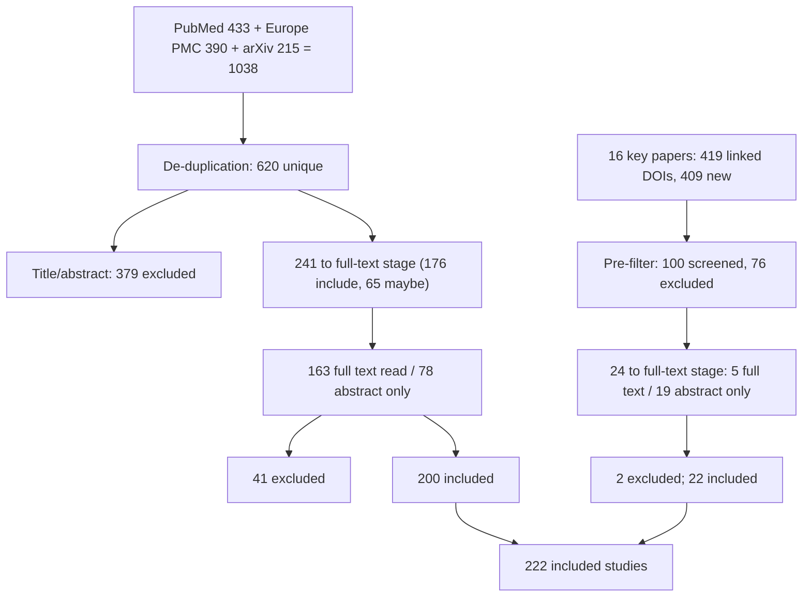

# Search and screening (PRISMA-ScR flow)

Executed on 2026-11-04 under the frozen protocol (`01-protocol.md`, amendments A1–A3). All counts below are computed
from the logs in `data/` (`search-log.csv`, `dedup-log.csv`, `screening-log.csv`, `screening-log-snowball.csv`,
`prisma-counts.csv`); `scripts/merge_screening.py` regenerates them.

## 1. Flow

| Stage | Main search | Snowballing | Total |
|---|---|---|---|
| Records identified | 1038 (PubMed 433; Europe PMC 390; arXiv 215) | 419 DOIs linked to 16 key papers | |
| Duplicates removed (DOI 402, title+year 11, arXiv ID 3, PMID 2) | 418 | 10 already in the main corpus | |
| Unique records / candidates | 620 | 409 | 1029 |
| Removed by the keyword pre-filter (not read) | – | 309 | |
| Screened on title/abstract | 620 | 100 | 720 |
| Excluded on title/abstract | 379 | 76 | 455 |
| Sent to full-text stage (include 176 + maybe 65; include 16 + maybe 8) | 241 | 24 | 265 |
| Open full text read | 163 | 5 | 168 |
| Decided on abstract only (no open full text) | 78 | 19 | 97 |
| Excluded at full-text stage | 41 | 2 | 43 |
| **Included studies** | **200** | **22** | **222** |

Of the 222 included studies: 204 contribute to RQ1, 26 to RQ2 and 53 to RQ3 (a study can serve several questions);
141 carry the DOI of a journal or proceedings publisher and 81 are preprints (only an arXiv ID or a preprint-server DOI; column `peer_reviewed` in `data/extraction.csv`; the flag is derived from the identifier, not from a check of each journal's review process); 20 are VR/AR/MR or CAVE
systems; **80 (36 %) rest on the abstract alone** because no open full text was found (these rows have
`evidence_base = abstract-only` and must not be quoted for numbers without checking the paper).

## 2. Sources and what did not work

| Source | Result |
|---|---|
| PubMed, Europe PMC, arXiv | blocks A, B, C run on 2026-11-04 (hits per query in `data/search-log.csv`) |
| OpenAlex keyword search | HTTP 429 on all three blocks (free daily budget exhausted on the network); not used for the search |
| Semantic Scholar | HTTP 429; not used |
| OpenCitations + OpenAlex single-record endpoint | used for snowballing and metadata |
| Scopus, Web of Science, IEEE Xplore | no access; equivalent queries in `data/queries-scopus-wos.md` |

The PubMed search was run twice (amendment A1: parser bug that mixed DOIs of cited references into records); both runs
are in the log with identical hit counts, and only the second is used.

## 3. Title/abstract screening

Rules: protocol Section 3 and amendment A2. One written instruction set was applied by five instances of the same AI
reviewer to five batches of the 620 records. Decisions are in `data/screening-log.csv`
(`decision_ta`, `reason_ta`, `rq`, `note`).

| Decision | n | Reasons for exclusion |
|---|---|---|
| include | 176 | |
| maybe (full text needed) | 65 | |
| exclude | 379 | E3 148 (not segmentation/annotation); E1 125 (fully automatic, text-only or auto-prompted); E2 52 (not CT/MR volumes); E5 31 (publication type, incl. reviews kept as background); E4 22 (tool used only as instrument); E6 1 (duplicate) |

No record was excluded as E7 (full text needed but unavailable): records without an open full text were decided on
the abstract and flagged (`fulltext_source = abstract-only`).

## 4. Snowballing

One round from 16 key papers (`data/snowball-seeds.csv`): the nine RQ2 systems (R0184, R0394, R0397, R0402, R0411,
R0435, R0536, R0505, R0390), two RQ1 clinical/tool papers (R0288, R0352), the foundation-model paper MedSAM, two deep
interactive methods (DeepIGeoS, BIFSeg), and two open-source tool/user-interaction papers (Gao 2024; Ramkumar 2016).
Backward and forward links came from OpenCitations (references, citations) and OpenAlex `referenced_works`: 365
referenced and 54 citing DOIs, 419 unique, 10 already in the main corpus, 409 new. A documented keyword rule (title or
abstract must mention segmentation/annotation/contour/label **and** an interaction or immersive term;
`scripts/snowball.py`) kept 100 candidates for screening; the other 309 were **not read** (a recall risk, see
Limitations). Of the 100: 16 include, 8 maybe, 76 exclude (E8 before 2015: 61; E2 4; E3 4; E4 3; E5 3; E1 1). The
E8 exclusions include classical papers that are listed as foundational references instead (protocol 3.3).

## 5. Full-text stage

Open full texts came from Europe PMC (58), arXiv (102) and publisher/repository open-access PDFs (3) for the main
corpus and 5 for the snowball set (`data/fulltext-availability*.csv`). **Full texts are not stored in the repository**
(copyright); `scripts/fulltext.py` re-fetches them. Groups: rq2a, rq2b (all RQ2 candidates), g1–g3 (RQ1/RQ3), and the
`maybe` group, each handled by an instance of the same AI reviewer with `data/fulltext-screening/instructions.md`.
Results were merged into the logs (`decision_ft`, `reason_ft`, `fulltext_source`, `note_ft`, `final_decision`,
`final_reason`) and into `data/extraction.csv`.

| Full-text decision (main corpus) | n |
|---|---|
| include | 200 |
| exclude E1 (automatic or auto-prompted) | 18 |
| exclude E2 (not CT/MR volumes) | 11 |
| exclude E4 (tool used as instrument) | 6 |
| exclude E3 (not segmentation/annotation) | 5 |
| exclude E5 (review) | 1 |

Snowball set: 22 included, 1 excluded E3, 1 excluded E2 (S091, see Section 6).

## 6. Manual checks after the merge (2026-11-04)

The checks listed in the handoff were done against the sources; results are in `data/manual-checks.csv` and applied by
`merge_screening.py`.

| Study | Check | Result |
|---|---|---|
| S020 (fully connected CRF tool) | abstract fetched (PubMed 34839271) | include confirmed (interactive, 2D and 3D, CT/MRI/US/X-ray; accuracy, repeatability, computation time evaluated; code for research use). No numbers in the abstract. |
| S023 (mandible: VR vs desktop vs AI) | abstract on the open repository page (publisher PDF not downloadable) | include confirmed; CT; 10 mandibles; Dice/HD values and "VR significantly faster" now in the table. Headset and engine unknown. |
| S091 (usability framework) | full text (Europe PMC, PMC6748179) | **excluded E2**: the user studies segmented RGB images converted to grayscale; CBCT only motivates the use case. Removed from the included set (223 → 222) and from the bibliography. |
| R0290 (whole-heart, CHD) | full text re-read | "Dice ~0.95" was read from a figure axis and is **not stated in the text**; accuracy field corrected. |
| R0004 (CT-SAM3D) | full text re-read | numbers confirmed: BTCV mDSC 78.4 % (1 click), 82.2 % (3 clicks); Table 9: 64³ input, 0.14 s/patch, 1240 MB, <10 s per organ vs manual 0.5 h or 1–2 h; the GPU used for the latency is not stated. |
| S057 (latency in scribble segmentation) | abstract re-fetched (PubMed 29683429) | consistent with the extraction; medical modality is not named in the abstract (borderline I2, kept). |
| R0186, R0411, R0505 (borderline RQ2) | decision reviewed | kept as included but **labelled borderline** in the RQ2 table: R0186 is general volume visualisation with a qualitative medical case; R0411 and R0505 annotate or trace in volumes (not voxel masks) and are abstract-only. |

**Correction to the handoff.** It stated that only R0402 and R0186 report rendering frame rate. R0179 (Meta Quest 3 +
stylus) also reports a sustained 72 FPS and a 3D-model update latency below 200 ms. The statement "no study measures
segmentation latency in VR from click to display" still holds: R0179's figure is for a manual stylus tool, R0394 says
only "within a few seconds", and R0184 does not quantify latency.

## 7. Decisions for the human re-check

1. All 80 abstract-only inclusions and the 97 abstract-only decisions in total (`fulltext_source = abstract-only`).
2. The 43 full-text-stage exclusions (reason in `note_ft`), especially E1 (auto-prompt boundaries) and E4.
3. The 309 snowball candidates removed by the keyword pre-filter (`snowball-candidates.csv`, `passes_prefilter = 0`).
4. Borderline: R0015 (CT of mummies, non-clinical), R0186, R0411, R0505, R0384, R0580, S002, S004, S005 (title only),
   S057 (modality).
5. Preprints (81 included): published versions may differ; check before citing numbers.

## 8. Limitations of this execution

- One AI reviewer (five instances) for screening and extraction; no second reviewer, no agreement statistic.
- Extraction values were copied from open full texts by an AI model; table and figure values in particular can be
  wrong. Numbers that matter for the article must be re-read in the paper. Two such errors were found in the manual
  checks (R0290, R0004 notes), so the error rate is not zero.
- No Scopus, Web of Science or IEEE Xplore; OpenAlex and Semantic Scholar keyword search unavailable. Block C (VR) is
  most exposed because IEEE VR/ISMAR/TVCG papers are poorly indexed in the sources used.
- Snowballing: one round, 16 seeds, keyword pre-filter.
- English only; 2015 to 2026-10-31.
